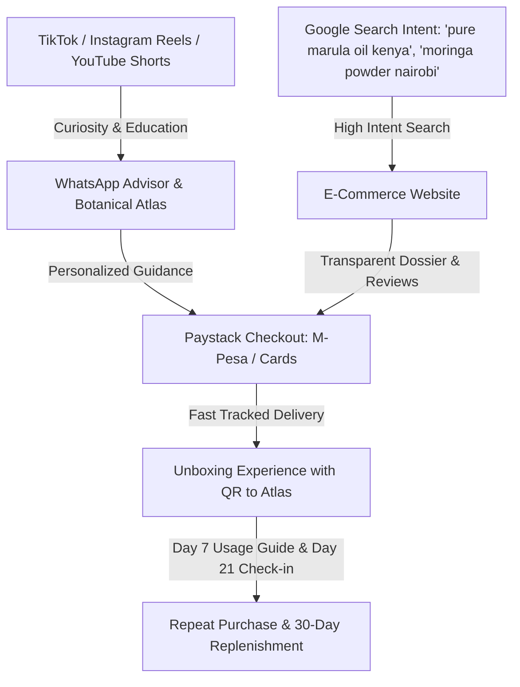

# NewAge Botanicals — Customer Research & Market Segmentation (Gate 2)

> **Guiding Principle:**  
> *Don't start by asking "What herbs should we sell?" Start with "Who is already spending money in this category, and why?"*

---

## 1. The Four Commercially Attractive Segments

### Segment A: The Wellness Beginner
- **Profile:** Urban Kenyan or East African professional (Age 24–38), living in Nairobi, Mombasa, Kampala, or Kigali. Experiencing daily work fatigue, sluggish digestion, or mild brain fog.
- **Current Category Spend:** Buys supermarket green tea, generic vitamin C effervescents, or packaged grocery honey (KES 1,500 – 3,500 / month).
- **Core Frustrations:** Overwhelmed by herbal jargon, intimidated by bitter raw herbs sold in open markets without labels, terrified of contamination or stomach upsets.
- **What They Want:**
  - Simple, single-ingredient daily products with clear instructions (e.g. "Add 1 spoon to warm water every morning").
  - Familiar, pleasant taste profiles (Baobab fruit, Hibiscus tea, Moringa powder).
  - Clear explanations of *why* it works without medical jargon.
- **Acquisition Hook:** Short-form video showing easy morning routines ("30 seconds to replace caffeine crashes").

---

### Segment B: The Natural-Lifestyle & Clean-Beauty Consumer
- **Profile:** Conscious consumer (Age 26–45) who actively reads ingredient labels. Currently shops at specialized organic grocers, health food shops, and premium pharmacies.
- **Current Category Spend:** Buys cold-pressed facial oils, imported matcha, organic chia seeds, and herbal tinctures (KES 4,000 – 12,000 / month).
- **Core Frustrations:** Frustrated by expensive imported Western wellness brands (e.g. European herbal brands charging 4x markups) when Africa produces the world's most potent botanicals; angry at local cosmetic products containing hidden hydroquinone, mineral oil, or synthetic fragrances.
- **What They Want:**
  - Pure, cold-pressed single-source oils (Virgin Marula, Frankincense facial elixirs).
  - Clean beauty guarantees (no parabens, no fillers, no artificial perfumes).
  - High aesthetic packaging that looks stunning on their bathroom counter.
- **Acquisition Hook:** Laboratory transparency and direct comparison ("Why your $80 European facial oil actually buys African Marula from our local growers").

---

### Segment C: The Traditional Botanical Enthusiast & Cultural Heritage Seeker
- **Profile:** Culturally proud individual or African diaspora resident (UK, US, Canada, EU) looking for authentic connection to indigenous African roots and botanical healing.
- **Current Category Spend:** Specialty ethnic markets, international shipping orders for indigenous tea/herbs, African diaspora e-commerce (USD $40 – $150 / order).
- **Core Frustrations:** Diaspora ethnic grocery stores often carry stale, poorly packaged herbs with zero batch dates or safety warnings.
- **What They Want:**
  - Genuine indigenous African botanicals (*Warburgia ugandensis*, *Adansonia digitata*, wild *Boswellia*).
  - Deep storytelling: Which community harvested this? What were the historical uses?
  - Ethical fair-trade compensation for local harvesters.
- **Acquisition Hook:** "The Botanical Atlas" and deep-dive heritage videos explaining the historical ethnobotany of Kenya and the Rift Valley.

---

### Segment D: The Premium Gifting & Executive Wellness Consumer
- **Profile:** High-income corporate executives, expatriates, and luxury lifestyle buyers seeking bespoke gifts, VIP discovery collections, and premium self-care rituals.
- **Current Category Spend:** Luxury spas, 5-star hotel boutiques, high-end gift hampers (KES 8,000 – 25,000 / transaction).
- **Core Frustrations:** Lack of refined, world-class Kenyan gift options that represent authentic luxury without looking like tourist trinkets.
- **What They Want:**
  - The **Founding Discovery Kit**: Heavy embossed boxes, amber glass jars with gold foil seals, brass measuring spoons, and a printed Botanical Field Guide.
  - White-glove WhatsApp ordering and same-day concierge delivery in Nairobi.
- **Acquisition Hook:** Exclusive seasonal batches and private discovery boxes.

---

## 2. Customer Acquisition Channels & Purchase Funnels

